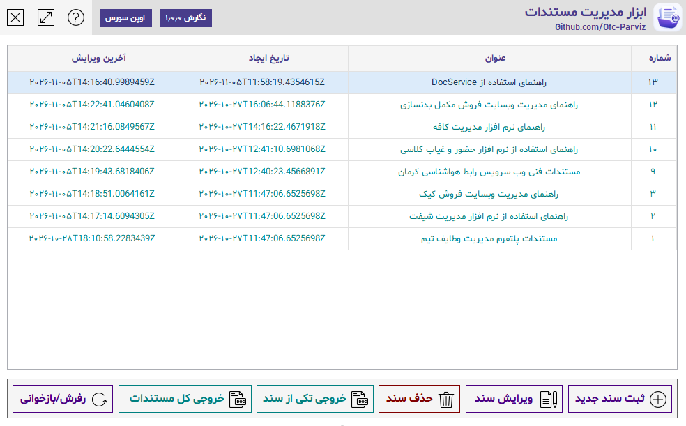
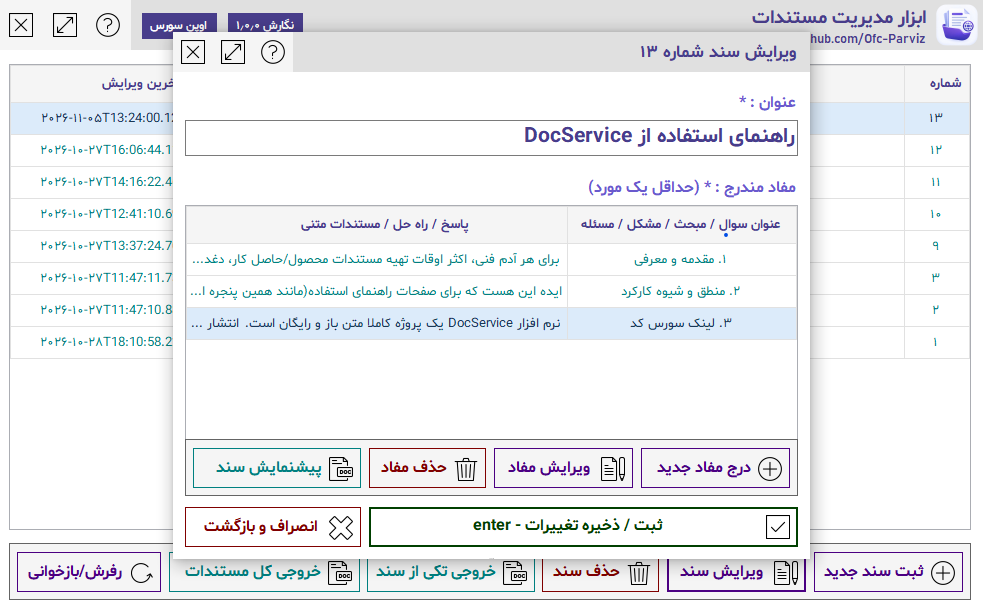
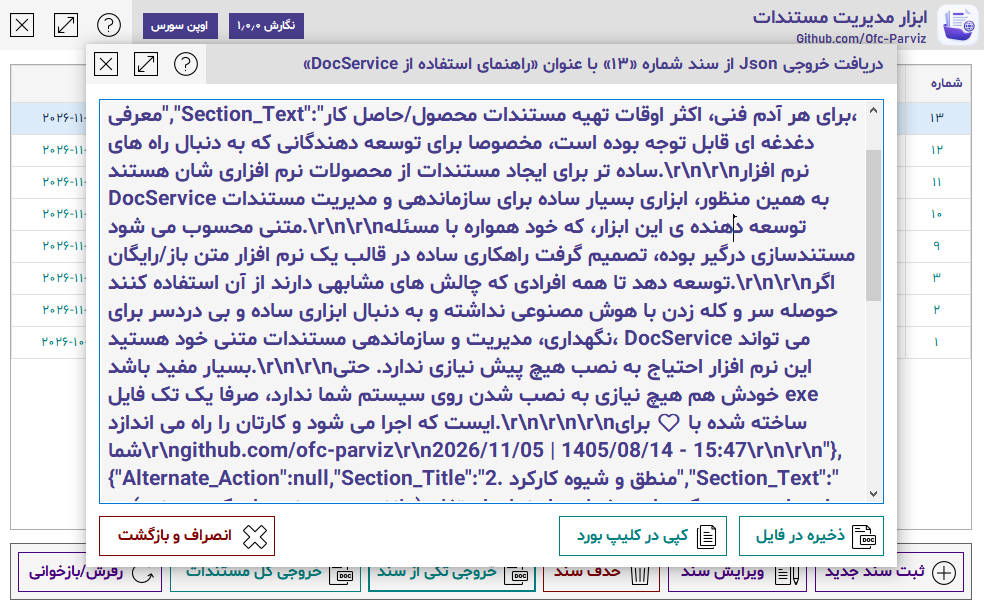

# ابزار سبک مدیریت و سازماندهی مستندات | DocService

<p align="right">
  <a href="README.md">🌐 Read in English (نسخه انگلیسی)</a>
</p>

<div dir="rtl">

**مستندات خود را ایجاد کنید، سازماندهی کنید، خروجی بگیرید و هر جا که نیاز دارید از آن استفاده کنید.**

نرم افزار DocService یک ابزار دسکتاپ سبک و کاربردی است که با هدف ساده‌سازی فرآیند ایجاد، سازماندهی، مدیریت و نگهداری مستندات متنی توسعه داده شده است.

مستندسازی بخش مهمی از فرآیند توسعه نرم‌افزار محسوب می‌شود؛ با این حال، تهیه و نگهداری مستندات محصولات، پروژه‌ها، APIها و فرآیندهای فنی، اغلب به کاری زمان‌بر و گاهی دشوار تبدیل می‌شود.

ابزار DocService برای حل همین مسئله طراحی شده است؛ با یک رویکرد ساده و کاربردی:

**مستندات خود را در یک محیط واحد مدیریت کنید و محتوای آن‌ها را از نحوه نمایش نهایی مستقل نگه دارید.**

## ✨ قابلیت‌های اصلی

- **مدیریت مستندات:** ایجاد، ویرایش و سازماندهی چندین سند در یک محیط متمرکز.
- **ساختاردهی محتوا:** تقسیم هر سند به بخش‌های مستقل که هرکدام عنوان و محتوای متنی مخصوص خود را دارند.
- **خروجی JSON:** دریافت خروجی کامل و ساختاریافته هر سند تنها با یک کلیک.
- **قابل‌حمل:** اجرای نرم‌افزار بدون نیاز به فرآیند نصب پیچیده.
- **مناسب برای توسعه‌دهندگان:** استفاده مجدد از داده‌های JSON خروجی در نرم‌افزارهای دیگر و پیاده‌سازی رابط‌های نمایش مستندات با طراحی دلخواه.
- **سازگار با گردش کار هوش مصنوعی:** ارائه فایل JSON به ابزارهای هوش مصنوعی به‌عنوان منبعی ساختاریافته برای تولید صفحات مستندات و محتواهای دیگر.
- **راهنمای داخلی:** مستندات راهنمای خود نرم‌افزار نیز با استفاده از DocService ایجاد و مدیریت شده است.

## 🖥️ تصاویر محیط برنامه

### محیط اصلی
مدیریت اسناد، مشاهده اطلاعات و دسترسی به عملیات مختلف از طریق یک رابط متمرکز.



### ویرایش سند
ایجاد و ویرایش اسناد از طریق تعیین عنوان و سازماندهی محتوا در قالب بخش‌های مستقل.



### دریافت خروجی JSON
دریافت تمام اطلاعات و محتوای یک سند در قالب JSON، همراه با امکان کپی در کلیپ‌بورد یا ذخیره در فایل.



## ⚙️ منطق و نحوه عملکرد

نرم افزار DocService از یک ساختار ساده و مشخص برای نگهداری مستندات استفاده می‌کند:

- **سند (Document):** شامل عنوان، اطلاعات به‌روزرسانی و مجموعه بخش‌های مربوط به سند است.
- **بخش (Section):** شامل عنوان و محتوای متنی مربوط به همان بخش است.

هر سند می‌تواند شامل چندین بخش باشد تا اطلاعات آن به قسمت‌های منطقی و قابل‌فهم تقسیم شود.

پس از تکمیل سند، DocService می‌تواند تمام اطلاعات آن را در قالب یک ساختار JSON در اختیار شما قرار دهد.

### نمونه ساختار خروجی JSON

```json
{
  "Title": "راهنمای استفاده از DocService",
  "Last_Updated_Date": "1405/08/14",
  "Last_Updated_Clock": "17:46:40",
  "Sections": [
    {
      "Alternate_Action": null,
      "Section_Title": "1. مقدمه و معرفی",
      "Section_Text": "معرفی نرم‌افزار DocService و کاربردهای آن..."
    },
    {
      "Alternate_Action": null,
      "Section_Title": "2. منطق و شیوه کارکرد",
      "Section_Text": "توضیح ساختار اسناد و نحوه استفاده از خروجی..."
    }
  ],
  "Need_Update": false,
  "Increase_Window_Size": false
}
```

نکته مهم این است که JSON خروجی به رابط کاربری DocService وابسته نیست. نرم‌افزارهای دیگر می‌توانند این داده را دریافت و پردازش کنند، آن را به قالب‌های نمایشی دلخواه تبدیل کنند یا در فرآیندهای مبتنی بر هوش مصنوعی مورد استفاده قرار دهند.

**ابزار DocService مدیریت محتوا را بر عهده می‌گیرد؛ نحوه استفاده و نمایش آن را شما تعیین می‌کنید.**

## 🚀 کاربردهای DocService

### مستندسازی پروژه‌های نرم‌افزاری
نگهداری و سازماندهی مستندات برنامه‌ها، کتابخانه‌ها، APIها و پروژه‌های توسعه نرم‌افزار.

### مستندات فنی و محصول
تهیه و مدیریت راهنماهای محصولات، دستورالعمل‌های فنی، یادداشت‌های داخلی و اطلاعات ساختاریافته.

### ایجاد رابط نمایش مستندات
استفاده از JSON خروجی در نرم‌افزارهای شخصی و پیاده‌سازی صفحات مستندات با طراحی، ساختار و شیوه پیمایش دلخواه.

### تولید محتوا با کمک هوش مصنوعی
فایل JSON خروجی را در اختیار یک دستیار هوش مصنوعی قرار دهید و از آن بخواهید بر اساس اطلاعات واقعی سند، صفحات راهنما، محتوای یک وب‌سایت یا قالب نمایشی دیگری ایجاد کند.

به این ترتیب، محتوای اصلی مستندات مستقل نگهداری می‌شود و هر زمان که نیاز به تغییر نحوه نمایش آن داشته باشید، می‌توانید از همان داده‌های ساختاریافته استفاده کنید.

## 🔍 نرم‌افزاری که مستندات خودش را نیز با خودش می‌سازد!

یکی از نمونه‌های عملی استفاده از DocService، مستندات راهنمای خود همین نرم‌افزار است.

راهنمای استفاده‌ای که همراه برنامه ارائه شده، با استفاده از خود DocService ایجاد و مدیریت شده است. سپس خروجی JSON آن در منابع برنامه قرار گرفته و هنگام اجرای نرم‌افزار برای ایجاد رابط نمایش راهنما مورد استفاده قرار می‌گیرد.

این موضوع نمونه‌ای واقعی از همان رویکردی است که DocService برای آن طراحی شده است:

**یک‌بار مستندات را ایجاد کنید، داده ساختاریافته آن را دریافت کنید و هر جا که نیاز دارید مجدداً از آن استفاده کنید.**

## 🛠️ فناوری‌های مورد استفاده

- C#
- Windows Forms
- .NET Framework 4.8.1
- SQLite

## 📦 دریافت و اجرا

برای دریافت نرم‌افزار، به بخش [Releases](https://github.com/ofc-parviz/DocService/releases) مراجعه کرده و فایل اجرایی را دانلود کنید.

فایل DocService.exe به‌صورت یک نرم‌افزار قابل‌حمل طراحی شده است و برای استفاده از آن نیازی به طی کردن فرآیند نصب متداول ندارید.

## 🌱 متن‌باز و رایگان

پروژه DocService یک نرم‌افزار کاملاً رایگان و متن‌باز است.

شما می‌توانید سورس کد آن را بررسی کنید، در فرآیندهای کاری خود به کار بگیرید و متناسب با نیازتان توسعه دهید یا شخصی‌سازی کنید.

**مخزن گیت‌هاب:**  
https://github.com/ofc-parviz/DocService

---

*ساخته‌شده با دقت و علاقه، برای توسعه‌دهندگان و تمام کسانی که به مستندات منظم و ساختاریافته اهمیت می‌دهند.*
