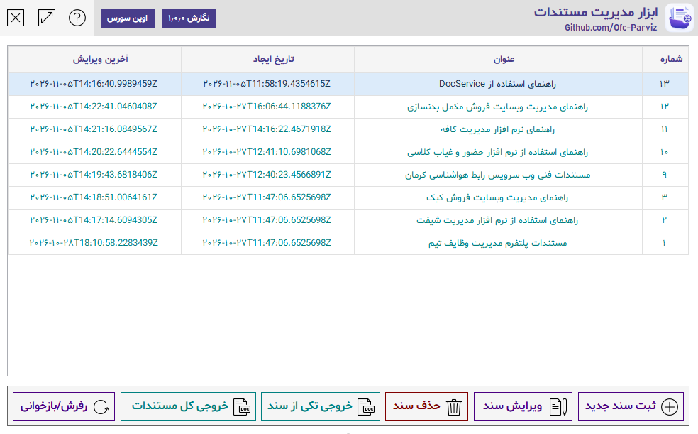
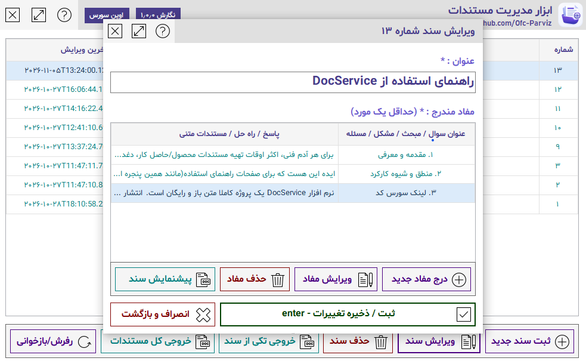
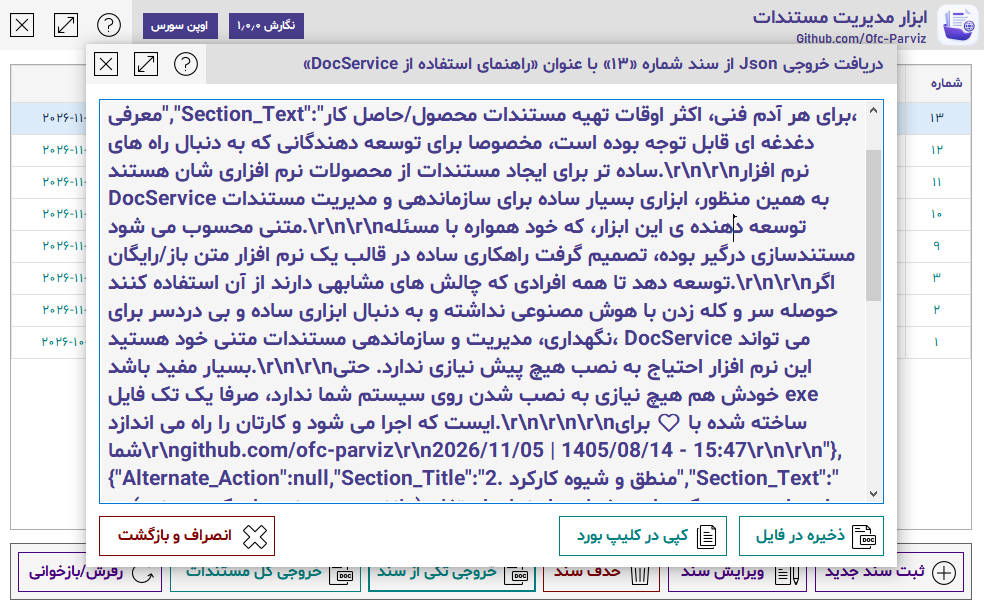

# DocService

<p align="left">
  <a href="README.fa.md">🌐 مطالعه به زبان فارسی (Persian Version)</a>
</p>

### A Lightweight Documentation Management Tool

**Create documentation. Keep it organized. Export it. Use it anywhere.**

DocService is a lightweight Windows desktop application designed to simplify the creation, organization, and management of textual documentation.

Documentation is an essential part of software development, but creating and maintaining it can often become a time-consuming task. Developers frequently need to document their projects, products, APIs, and technical workflows, yet the process of organizing and maintaining this information is not always straightforward.

DocService was created to address this problem with a simple and practical approach: **manage your documentation in one place and keep its content independent from how it is eventually presented.**

## ✨ Key Features

- **Document Management:** Create, edit, and organize multiple documentation documents in a centralized environment.
- **Structured Sections:** Divide each document into individual sections, each containing its own title and textual content.
- **JSON Export:** Export complete documents as structured JSON files with a single action.
- **Portable:** Run the application without a complicated installation process.
- **Developer-Friendly:** Reuse exported JSON data in your own applications and build custom documentation interfaces.
- **AI-Friendly:** Provide exported JSON files to AI assistants as structured source material for generating documentation pages and other content.
- **Built-in User Guide:** Explore the application's own documentation, which was created and managed using DocService itself.

## 🖥️ Screenshots

### Main Interface
Manage your documents, review their information, and access document operations from a centralized interface.



### Document Editor
Create and edit documents by defining their titles and organizing their content into individual sections.



### JSON Export
Export the complete content of a document as JSON, then copy it to the clipboard or save it as a file.



## ⚙️ How It Works

DocService uses a simple, structured document model:

- **Document:** Contains the document title, update information, and its sections.
- **Section:** Contains a section title and its corresponding text content.

A document can contain multiple sections, allowing you to organize information into logical and readable parts.

Once your document is ready, DocService generates a JSON representation containing the complete document data.

### Example JSON Structure

```json
{
  "Title": "Getting Started with DocService",
  "Last_Updated_Date": "1405/08/14",
  "Last_Updated_Clock": "17:46:40",
  "Sections": [
    {
      "Alternate_Action": null,
      "Section_Title": "1. Introduction",
      "Section_Text": "An introduction to DocService..."
    },
    {
      "Alternate_Action": null,
      "Section_Title": "2. How It Works",
      "Section_Text": "An explanation of the document structure..."
    }
  ],
  "Need_Update": false,
  "Increase_Window_Size": false
}
```

The exported JSON is not tied to DocService's user interface. It can be consumed by other applications, transformed into custom presentation formats, or used as input for AI-assisted workflows.

**DocService manages the content. You decide how to use and present it.**

## 🚀 Use Cases

### Software Documentation
Maintain documentation for your applications, libraries, APIs, and development projects.

### Product and Technical Documentation
Organize product guides, technical instructions, internal notes, and structured information.

### Custom Documentation Interfaces
Use the exported JSON in your own software to create documentation pages with your preferred design and navigation.

### AI-Assisted Content Generation
Give an AI assistant your exported JSON and ask it to generate a documentation interface, website content, or another presentation based on the actual document data.

This approach allows you to maintain the source content separately and regenerate its presentation whenever necessary.

## 🔍 A Self-Documenting Application

DocService is also used to document itself.

The user guide included in the application was created and maintained using DocService. Its JSON output is embedded into the application and converted into the help interface at runtime.

This is a practical demonstration of the application's intended workflow: **create documentation once, export its structured data, and reuse it wherever needed.**

## 🛠️ Technology Stack

- C#
- Windows Forms
- .NET Framework 4.8.1
- SQLite

## 📦 Getting Started

Download the application executable from the [Releases](https://github.com/ofc-parviz/DocService/releases) section and run it.

DocService is designed as a portable application, so there is no conventional installation process.

## 🌱 Open Source

DocService is free and open-source software.

You are welcome to explore its source code, use it in your own workflows, and adapt it to your requirements.

**GitHub Repository:**  
https://github.com/ofc-parviz/DocService

---

*Built with care for developers and everyone who values well-organized documentation.*
